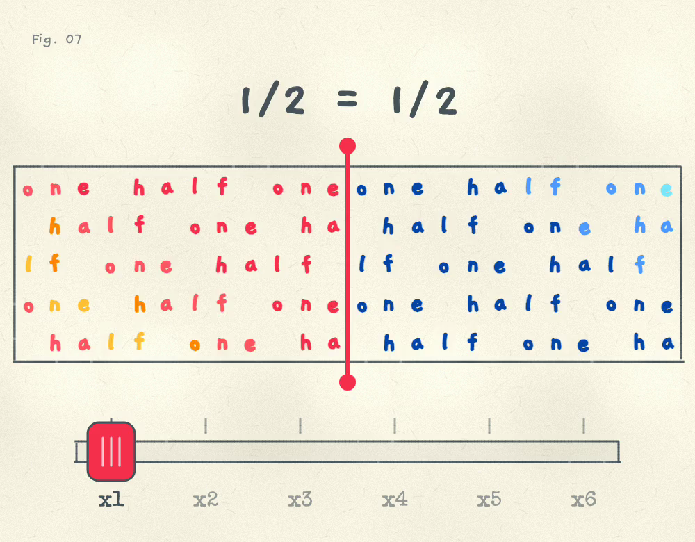

# The Same Amount

Fig. 07 in my "math facts that live in my head" series. Cut a fraction finer and the amount never changes: a/b = ka/kb.

A bar of hand-lettered letters. The filled part spells the fraction's name in warm, shimmering marker colours, and the rest of the bar spells the rest of the whole in blues, so it always adds up to 1. Drag the red edge to change the fraction. Shove the heavy throttle underneath to cut the bar 2, 3, up to 6 times finer: the cuts slam down with a CLUNK and the top line reads 2/3 = 8/12, but not one letter moves.

Open it: https://ibeez.github.io/same-amount/



[Watch one loop (MP4)](exports/same-amount-loop.mp4): 20 seconds with sound, H.264 + AAC, 1000 × 780 at 30 fps.

## Run It Locally

```bash
python3 -m http.server 8772 --bind 127.0.0.1
```

Then open http://127.0.0.1:8772/.

Drag the red edge or the throttle, or use the arrow keys (left and right for the throttle, up and down for the edge). Touch it once to start the music. The `sound` button mutes it. Reduced motion turns off the demo, the shake and the shimmer.

Re-render the video with `python3 render.py`. Headless Chrome renders `index.html?render` one frame at a time, the page renders the audio offline, OpenCV encodes the frames, and ffmpeg adds the sound.

## How It Works

One canvas, plain JavaScript, no libraries. The bar is 24 letters wide, so halves, thirds, fourths, sixths and eighths all end between two letters. The throttle is a heavy spring that trails your hand and snaps to the notch where you let go. The edge is a stiff spring onto each fraction. The lines are printshop rules: dead straight, with faint uneven ink and slightly imperfect joints.

All sound is synthesized with Web Audio: a soft flute over pad chords and a sine bass in a long reverb, an 8-bit clunk and crunch when the cuts land, a tick when the lever settles, and a xylophone note per fraction. Notes for other pieces: [`../chiptune-music.md`](../chiptune-music.md).
